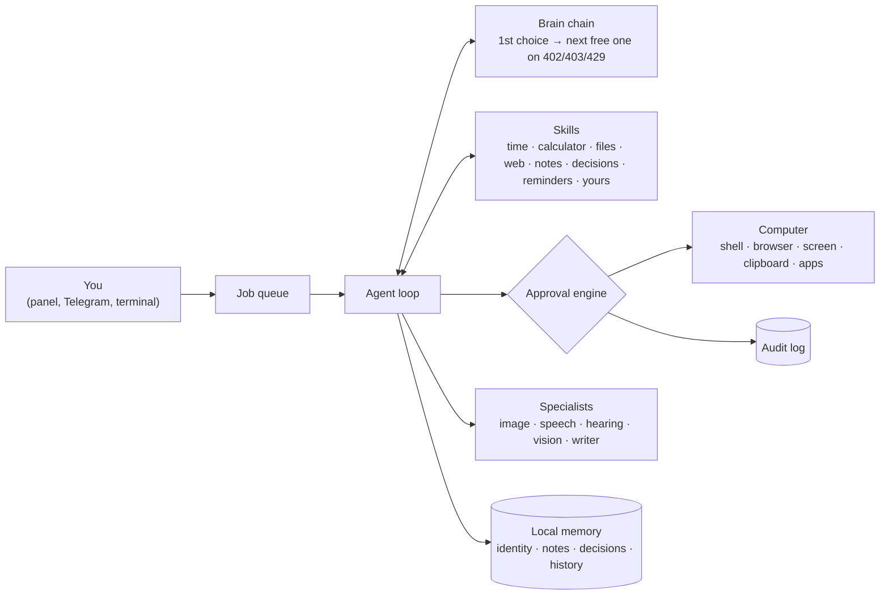

# 🤖 PocketAgent

[](https://github.com/wansjaxell/pocket-agent/actions/workflows/ci.yml)

**A small, local-first AI agent you can run on your own computer for free.**
Set it up in a local web panel, plug in one or more free brains, and talk to it from the panel
or from Telegram on any phone. It can use your computer too, but only what you approve.

- **One file to start:** download `PocketAgent.exe`, double-click, and the setup panel opens in your browser
- **Free brains, with fallbacks:** OpenRouter (sign in, no key to copy), Groq, Google AI Studio, NVIDIA,
  GitHub Models, Cerebras, Ollama, LM Studio, or any OpenAI-compatible API. If one runs out of free
  credit, the next one answers, and every answer says which brain wrote it. OpenRouter's free models
  (several with 1M-token context) can be added and kept up to date automatically
- **Specialists:** the agent writes a prompt and hands it to an image, speech or writing model; the
  picture, audio or file comes back in the chat and on Telegram
- **Telegram with your voice:** send voice messages and photos; it can answer with a voice message,
  in Turkish too, with Piper running offline on your computer
- **Documents:** reads Word, Excel, PowerPoint and PDF files, writes Word and Excel files
- **Scheduled tasks:** "every weekday at 08:00, send me the weather"
- **A real browser:** its own Edge or Chrome window reads pages after their JavaScript ran, clicks and types
- **Its own memory:** name, personality, notes and a decision log that stay the same whichever brain you use
- **Your keys, encrypted if you want:** lock the panel with a password and the API keys are stored encrypted
- **Computer use with approvals:** commands, the browser, screenshots, clipboard, opening programs; off
  by default, every action needs your OK, and one button stops everything
- **English or Turkish** interface (English by default)
- **Small:** two pure-Python packages (`requests`, and `pypdf` for PDF files), a single executable, 275 tests


## How it works



1. Your message goes to the first brain in your list, together with the tools it may use.
2. If the brain wants a tool (for example `calculate`), PocketAgent runs it and sends back the result.
   Tools that act on the computer go through the approval engine first.
3. This repeats (at most 8 steps) until the brain writes the final answer.

Models without native tool calling still work: tools are then described in the prompt instead
(`{"tool": ..., "arguments": ...}` in plain text). This is detected when you add the brain.

## Quick start

### Windows: one file
1. Download `PocketAgent-windows.exe` from [Releases](https://github.com/wansjaxell/pocket-agent/releases)
2. Double-click it. Windows SmartScreen may warn about an unsigned app: **More info → Run anyway**
3. Your browser opens the panel at `http://127.0.0.1:8765`. Follow the four steps (about 2 minutes)

Keep the PocketAgent window open while you use the agent; closing it stops the agent.
**Settings → Put a PocketAgent icon on the desktop** makes a desktop icon that always starts this copy.
If an older PocketAgent is still running when you start a newer one, the newer one closes it and
takes its place (the same version is simply reopened in the browser).

### Any computer with Python 3.10+
```bash
pip install git+https://github.com/wansjaxell/pocket-agent
pocketagent
```

### Android (Termux) and computers without a browser
Install [Termux from F-Droid](https://f-droid.org/packages/com.termux/), then:
```bash
pkg install python
pip install git+https://github.com/wansjaxell/pocket-agent
pocketagent setup
pocketagent telegram
```
`pocketagent setup` is the terminal version of the setup. A phone cannot run a 9B+ model well,
so choose a free cloud brain, or point it at the Ollama on your home computer (see below).

### iPhone and everything else
Run PocketAgent on a computer and chat with it through **Telegram**, which works on every platform.

## The setup panel

The panel is one page that only your own computer can open. Its steps:

1. **Connect a brain.** Pick a provider. OpenRouter signs you in from the browser (OAuth PKCE): no key
   to copy. For the others, **Get your free key** opens the right page; paste the key, and the panel
   checks it and lists the models in a table you can search and filter (free only, minimum context,
   tool calling). Add as many brains as you like and put them in order.
2. **Connect Telegram** (optional). Create a bot with @BotFather, paste its token, then press START
   in your bot. The first person who presses START becomes the owner; everyone else is refused.
3. **Name your agent**, and optionally describe its personality.
4. **Access:** *open* (no password) or *locked* (a password, and the keys are stored encrypted).
5. **Specialists** (optional): who makes images, speech and long texts (see below).

The panel also has the chat, a **Safety** tab (computer use, approval rules, jobs, audit log), an
EN/TR language switch (English until you pick Türkçe) and the **STOP** button.

## Choosing a brain

| Provider | Cost | Notes |
|---|---|---|
| [OpenRouter](https://openrouter.ai) | free models available | sign in from the panel; free models are marked |
| [Groq](https://console.groq.com/keys) | free tier | very fast |
| [Google AI Studio](https://aistudio.google.com/apikey) (Gemini) | free tier | ⚠️ on the free tier your messages may be used to train Google's models |
| [NVIDIA build.nvidia.com](https://build.nvidia.com) | free tier | Nemotron models |
| [GitHub Models](https://github.com/settings/personal-access-tokens/new) | free with a GitHub account | fine-grained token with the *Models: Read* permission |
| [Cerebras](https://cloud.cerebras.ai) | free tier | very fast |
| [Ollama](https://ollama.com) | free | everything stays on your PC: `ollama pull qwen3.5:9b` |
| [LM Studio](https://lmstudio.ai) | free | everything stays on your PC: start its local server |
| Custom | | any OpenAI-compatible address, e.g. `http://192.168.1.5:11434/v1` |

**Fallbacks.** The first brain in your list answers. If it answers HTTP 402 (out of credit),
403 (refused), 404 (model gone), 408, 429 (rate-limited) or 5xx (down), the next *free* brain in your
list answers instead; paid models are never used as fallbacks. A wrong key (401) or a bad request
(400) is shown, not hidden. If every brain fails, the error lists what happened to each one.
Under each answer you see the brain that wrote it, e.g. `🧠 Gemini · gemini-2.5-flash (↪ Groq · llama-3.3-70b-versatile: HTTP 429)`.

**Switching brains off.** Every brain, and every provider as a whole, has an on/off switch: switched-off
brains stay in the list but are never asked. Brains without a key are skipped too, and a saved key
can be deleted (e.g. a wrong one). NVIDIA's and GitHub's model lists answer any key, so their keys are
checked with one tiny request when you save them.

**OpenRouter's free limit.** Free OpenRouter models allow 20 requests a minute and **50 a day for the
whole account** (1000 a day after a one-time $10 top-up), and the agent may use several requests per
message. When the daily limit is reached, PocketAgent skips OpenRouter's free models until the reset
time (the panel shows it) instead of failing on every message. Add brains from other providers (NVIDIA,
Groq, Gemini, Cerebras) so there is always one that answers. Some free OpenRouter models are kept for
other apps only ("agentic harnesses"); PocketAgent switches those off and never adds them again.

**OpenRouter's free models, automatically.** In the OpenRouter part of step 1, **Add / update now**
puts OpenRouter's free models that support tool calling behind your own brains, biggest context
first (e.g. 1M-token Nemotron 3 Ultra, Inkling), with `openrouter/free` (OpenRouter's own router over
its free models) last. Choose how many and the minimum context. Free models come and go, so tick
**Keep it current** to refresh the list every 12 hours. A model you move by hand stays where you put
it; one you remove is not added again. They are tagged 🔄 in the list.

If OpenRouter answers *"No endpoints found matching your data policy"*, its privacy settings block
free models: allow them at [openrouter.ai/settings/privacy](https://openrouter.ai/settings/privacy).

**Which local model fits your computer?**

| Graphics memory | Suggested models | |
|---|---|---|
| 8 GB | `qwen3.5:9b`, `granite4.2:8b` | fit in the GPU: fast |
| 16 GB+ (GPU or RAM) | `gpt-oss:20b`, `qwen3:30b` | mixture-of-experts: larger, slower if they spill into RAM |
| 24 GB+ | 32B dense models | a 32B model needs about 20 GB to run well |

### Use your PC's model from other devices
Let Ollama listen on your network (`OLLAMA_HOST=0.0.0.0`, then restart Ollama), and on the
other device choose **Custom** with `http://<your-pc-ip>:11434/v1`.

## Specialists: images, speech, writing

One agent stays in charge. When you ask for a picture, a voice recording or a long program or
document, the agent writes a detailed prompt and hands it to a specialist: one call, prompt in,
result out. The result is saved in the workspace's `media` folder (or the path the agent chose),
shown in the panel's chat and sent on Telegram. Choose the specialists in step 5; all are off until
you pick one, because what you send them leaves your computer.

| Specialist | Services | |
|---|---|---|
| 🖼 Images (`create_image`) | [Pollinations](https://pollinations.ai) | free; works **without a key** (classic model, rate-limited); a free key from [enter.pollinations.ai](https://enter.pollinations.ai/keys) unlocks models such as FLUX schnell |
| | OpenRouter image models | **paid** (OpenRouter has no free image model): every image asks for your approval, like any spending |
| | your own OpenAI-compatible server | `/v1/images/generations` |
| 🔊 Speech (`create_speech`) | Pollinations | free, needs the free Pollinations key |
| | this computer's voices | free and offline (Windows speech voices, macOS `say`) |
| | your own OpenAI-compatible server | `/v1/audio/speech` |
| | Piper | free, natural voices **on this computer, offline**, Turkish (`tr_TR-dfki-medium`) and English; installed from the panel (about 85 MB) |
| ✍️ Writing / code (`ask_specialist`) | any of your brains | e.g. a coding model for long code; can save the result as a file |
| 👂 Hearing (Telegram voice messages) | Groq Whisper | free with the Groq key; or your own server (`/v1/audio/transcriptions`) |
| 👁 Seeing (`look_at_image`) | a model that sees pictures | e.g. `nvidia/nemotron-3.5-super-vl:free` or `google/gemma-4-31b-it:free` on OpenRouter, or Gemini |

**Telegram with voice and photos.** Send a voice message: it is written down (you see what was
understood) and handled like a typed message. Send a photo or a file: it is saved in the workspace's
`inbox` folder and the agent looks at it (`look_at_image`) or reads it (`read_document`). **Voice
replies** can be off, on when you sent a voice message, or always: the answer then also arrives as a
voice message. MP3 voices (Pollinations) show as a voice bubble; WAV voices (Piper, Windows) arrive as
an audio file unless [ffmpeg](https://ffmpeg.org) is installed, which turns them into voice bubbles.

Local video generation (e.g. Wan 2.2 through ComfyUI) is planned as a later update.

## Memory that belongs to the agent

These files belong to the agent, not to the brain. They are added to every conversation, so
switching to another model changes how it thinks, not who it is or what it knows:

| File (in `memory/`) | |
|---|---|
| `identity.json` | name and personality |
| `notes.json` | facts it was asked to remember (`remember`, `recall`, `forget`) |
| `decisions.jsonl` | the decision log: important decisions made with you (`record_decision`, `list_decisions`), append-only |
| `conversations.json` | recent conversation per chat |

## Computer use and approvals

Computer use is **off** by default (safe mode: chat only). In safe mode the agent cannot see or call
the computer tools. The sandboxed skills keep working: workspace files, web reading, notes, reminders.
Turn computer use on in the panel's **Safety** tab. Then:

- **Every action asks first**, in the panel and in Telegram (with buttons): *Allow once*, *Allow + remember*, *Deny*.
- **An approval opens a narrow rule, not a category.** A remembered approval matches only the exact
  same action: the same command in the same folder, or the same website. A new folder, recipient,
  amount or site is asked again.
- **Some things always ask and are never remembered:** spending money, deleting files, sending a
  message, passwords and keys, and **anything that comes after the agent read a web page, a file or
  command output in the same turn**. Instructions hidden in that content cannot trigger an action on
  their own (prompt-injection defence).
- **No ceilings:** there is deliberately no limit on how often an approved action may run.
- **STOP:** the big **STOP** button in the panel, or `/dur` (or `/stop`) in Telegram, stops everything
  at once: waiting approvals are denied, running commands are killed, queued jobs are cancelled, the
  current answer ends, and computer use is turned off until you turn it on again.
- **Saved rules** are listed in the Safety tab, where you can delete them one by one (`/kurallar` or
  `/rules` in Telegram lists them).
- **Everything is logged:** each tool call and each decision goes to `logs/audit.jsonl`, is shown in
  the Safety tab and is printed in the PocketAgent window.

The agent is a single agent with one background job queue: messages from the panel and Telegram are
answered one after another, while approvals and STOP are handled at once.

## Scheduled tasks

Ask for it in plain words: *"every weekday at 08:00, send me the weather in Istanbul"*. The agent
saves the task (`schedule_task`); at the time, it runs in the background like a message from you and
the answer arrives where you asked (Telegram or the panel). Tasks can run once, hourly, daily, on
weekdays, weekly, or every N minutes or hours (at most every 5 minutes, to spare free quotas). If the
computer was off, a missed task runs once at the next start. Actions on the computer inside a task
still ask for approval, and a task requested after reading a web page or a file needs your approval
too, so a page cannot plant a standing job. See and cancel them in the **Safety** tab or with `/tasks`
(`/gorevler`) on Telegram.

## Built-in skills

| Skill | Tools |
|---|---|
| basics | `get_current_time`, `calculate` (safe math, no `eval`) |
| files | `list_files`, `read_file`, `write_file` (only inside the workspace folder) |
| web | `web_search` (DuckDuckGo, no key), `fetch_webpage` |
| notes | `remember`, `recall`, `forget` |
| decisions | `record_decision`, `list_decisions` |
| reminders | `set_reminder`, `list_reminders`, `cancel_reminder` (delivered on Telegram or in the panel) |
| documents | `read_document` (Word, Excel, PowerPoint, PDF, text), `write_word`, `write_excel` |
| schedule | `schedule_task`, `list_tasks`, `cancel_task` |
| specialists | `create_image`, `create_speech`, `look_at_image`, `ask_specialist` (see *Specialists*) |
| shell | `run_command`: PowerShell on Windows, `sh` elsewhere (computer use, approval for every command) |
| browser | `browser_go`, `browser_read`, `browser_click`, `browser_type`, `browser_scroll`, `browser_screenshot` in the agent's own window; `open_in_browser` in yours (computer use) |
| desktop | `take_screenshot`, `read_clipboard`, `write_clipboard`, `open_app` (computer use) |

**The agent's browser** is Edge (or Chrome) in a visible window with a separate PocketAgent profile:
none of your own logins or passwords. It reads pages the way you see them, after their JavaScript ran
and their prices loaded. Going to a site is approved per site; every click and every typed text is
asked again (they come after reading a page), and buy/delete/send words are flagged. The agent never
types into password fields: you log in yourself in the open window. It does not solve captchas.
**STOP** closes it.

**Desktop:** screenshots can be remembered as allowed; reading the clipboard is asked every time and
never remembered (it may hold a copied password); `open_app` opens programs by name (word, excel,
hesap makinesi...) or files and folders, with a rule as narrow as program + file, and never command
shells (those go through `run_command`, where each command is shown).

**Documents** in the workspace (including files sent on Telegram) are read freely; files elsewhere on
the computer need computer use and your approval for their folder. Word and Excel files the agent
writes are delivered with the answer.

### Write your own skill
A skill is a Python file with documented functions. Type hints and the docstring become the
tool description the model sees. Put the file in your skills folder and restart:

```python
from pocketagent.tools import tool

@tool
def roll_dice(sides: int = 6) -> str:
    """Roll a die.

    Args:
        sides: number of sides
    """
    import random
    return str(random.randint(1, sides))
```

A skill that acts on the computer is marked `@tool(os_access=True)` and asks first with
`ctx.approve(Action(kind, summary, params, scope=..., classes=...))` (see `pocketagent/skills/shell.py`).
Mark tools that return outside content with `untrusted_output=True`.

| | PocketAgent folder (settings, memory, skills, logs) |
|---|---|
| Windows | `%APPDATA%\PocketAgent\` (skills in `skills\`) |
| macOS / Linux | `~/.pocketagent/` |

A complete example (current weather, free API) is in [`examples/skills/weather.py`](examples/skills/weather.py).

## Commands

| Command | |
|---|---|
| `pocketagent` | opens the panel in your browser; Telegram and reminders run in the background |
| `pocketagent --no-browser` / `--port 9000` | start without opening the browser / on another port |
| `pocketagent setup` | terminal setup (for computers without a browser) |
| `pocketagent chat` | terminal chat only (approvals are asked in the terminal) |
| `pocketagent telegram` | Telegram bot only, without the panel |
| `pocketagent skills` | list loaded skills |
| `pocketagent doctor` | test the brains and Telegram |

In Telegram: `/dur` or `/stop` stops everything, `/kurallar` or `/rules` lists approval rules,
`/gorevler` or `/tasks` lists scheduled tasks, `/reset` clears the conversation, `/skills` lists what
the agent can do. Voice messages, photos and files work too.

**Start with Windows:** tick the option in the panel. It adds a shortcut to your Startup folder that
opens the normal PocketAgent window minimized (never hidden). In locked mode the browser opens so you
can type the password.

## Security

- **The panel only listens on 127.0.0.1.** Other computers on your network cannot reach it.
  Web pages you visit cannot use it either: the Host header must be `127.0.0.1` or `localhost`
  (against DNS rebinding), every API call needs a random token embedded in the page and requests from
  other origins are refused (against CSRF), and the page cannot be shown inside another site (against
  clickjacking). Everything from models and web pages is shown as text, never as HTML.
- **Locked mode** encrypts the API keys and the Telegram token with a key derived from your panel
  password: scrypt (N=2¹⁵, r=8) → AES-256-CTR + HMAC-SHA256 (encrypt-then-MAC). Python's standard
  library has no AES, so AES is a small pure-Python implementation checked against the FIPS-197 and
  NIST SP 800-38A test vectors. The password is
  never stored; if you forget it, the vault is deleted and you enter the keys again. In open mode the
  keys are stored as plain text in `config.json` in your user folder.
- **Telegram is owner-only.** The first person to press START during setup becomes the owner; every
  other chat is refused and never reaches the model, and their buttons do nothing.
- **Computer use** is off until you turn it on, and then every action needs your approval (see above).
- **Specialists** are off until you choose them; paid ones ask for approval every time. Files they
  make are only served from the workspace, and the panel shows images and audio but never renders
  other files as pages.
- **File tools are sandboxed** to the workspace folder; paths like `../../Windows` are rejected.
- **Web pages, files and command output are untrusted:** the model is told not to follow instructions
  inside them, and any action after reading them needs a fresh approval.
- **The agent is never hidden:** it runs in a visible window and logs what it does.
- **Skills are code.** Only add skill files you have read or trust.

## Development

```bash
pip install -e ".[dev]"
pytest                                   # 275 tests, no network, model, Telegram or OS calls
pyinstaller --onefile --name PocketAgent --collect-submodules pocketagent.skills --exclude-module numpy --exclude-module PIL --exclude-module cryptography --exclude-module Crypto --exclude-module yaml --exclude-module cffi --exclude-module setuptools pocketagent/__main__.py
```

The `--exclude-module` options keep optional packages that pypdf could use (and that may be installed
on your computer) out of the executable; PDF text reading does not need them.

Tests replace the model servers, Telegram, the browser and the operating system with small fakes,
so they are fast and repeatable. Pushing a tag such as `v0.4.0` builds Windows, macOS and Linux
executables with GitHub Actions and attaches them to a release.

## Roadmap

- Local image and video generation through ComfyUI (e.g. Wan 2.2)
- Local speech-to-text (whisper.cpp)
- Mail: read, summarise, draft (sending to a new person always asked)
- Installing skills from a URL, with a review step
- MCP (Model Context Protocol) tool servers

## License

MIT
