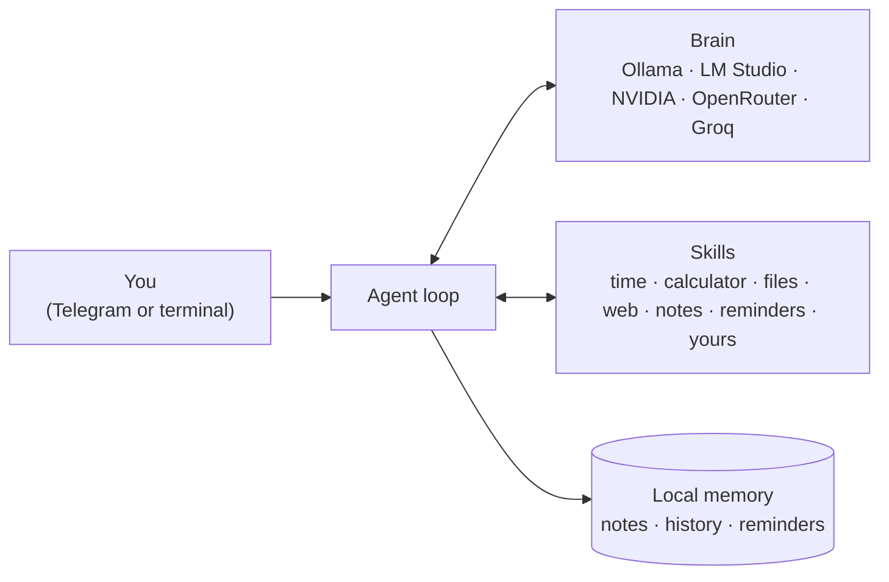

# 🤖 PocketAgent

[](https://github.com/wansjaxell/pocket-agent/actions/workflows/ci.yml)

**A small, local-first AI agent you can run on your own computer for free.**
Plug in any brain (a local model with Ollama or LM Studio, or a free cloud API), add
skills as simple Python files, and talk to it from the terminal or from Telegram on any phone.

- **One file to start:** download `PocketAgent.exe`, double-click, answer 2-3 questions
- **Automatic setup:** finds local models on your computer, tests them, connects Telegram
- **Free and private:** with Ollama, nothing leaves your computer
- **Skills:** clock, calculator, files, web search, long-term memory, reminders, and your own
- **Tiny:** one dependency (`requests`), 11 MB executable, 62 tests on Windows, macOS and Linux


## How it works



1. Your message goes to the brain together with the list of available tools.
2. If the brain wants a tool (for example `calculate`), PocketAgent runs it and sends back the result.
3. This repeats (at most 8 steps) until the brain writes the final answer.

Models without native tool calling still work: the setup detects this and describes the
tools in the prompt instead (`{"tool": ..., "arguments": ...}` in plain text).

## Quick start

### Windows: one file
1. Download `PocketAgent-windows.exe` from [Releases](https://github.com/wansjaxell/pocket-agent/releases)
2. Double-click it. Windows SmartScreen may warn about an unsigned app: **More info → Run anyway**
3. Follow the setup (about 2 minutes)

### Any computer with Python 3.10+
```bash
pip install git+https://github.com/wansjaxell/pocket-agent
pocketagent
```

### Android (Termux)
Install [Termux from F-Droid](https://f-droid.org/packages/com.termux/), then:
```bash
pkg install python
pip install git+https://github.com/wansjaxell/pocket-agent
pocketagent
```
A phone cannot run a 9B+ model well, so choose a free cloud brain, or point it at the
Ollama on your home computer (see *Use your PC's model from other devices* below).

### iPhone and everything else
Run PocketAgent on a computer and chat with it through **Telegram**, which works on every platform.

## Choosing a brain

| Option | Cost | Privacy | Notes |
|---|---|---|---|
| [Ollama](https://ollama.com) | free | everything stays on your PC | `ollama pull qwen3.5:9b` |
| [LM Studio](https://lmstudio.ai) | free | everything stays on your PC | start its local server |
| [NVIDIA build.nvidia.com](https://build.nvidia.com) | free tier | cloud | Nemotron models |
| [OpenRouter](https://openrouter.ai) | free models available | cloud | many models |
| [Groq](https://console.groq.com) | free tier | cloud | very fast |

**Which local model fits your computer?**

| Graphics memory | Suggested models | |
|---|---|---|
| 8 GB | `qwen3.5:9b`, `granite4.2:8b` | fit in the GPU: fast |
| 16 GB+ (GPU or RAM) | `gpt-oss:20b`, `qwen3:30b` | mixture-of-experts: larger, slower if they spill into RAM |
| 24 GB+ | 32B dense models | a 32B model needs about 20 GB to run well |

### Use your PC's model from other devices
Let Ollama listen on your network (`OLLAMA_HOST=0.0.0.0`, then restart Ollama), and on the
other device choose **Other OpenAI-compatible API** with `http://<your-pc-ip>:11434/v1`.

## Built-in skills

| Skill | Tools |
|---|---|
| basics | `get_current_time`, `calculate` (safe math, no `eval`) |
| files | `list_files`, `read_file`, `write_file` (only inside the workspace folder) |
| web | `web_search` (DuckDuckGo, no key), `fetch_webpage` |
| notes | `remember`, `recall`, `forget` (saved notes are added to every conversation) |
| reminders | `set_reminder`, `list_reminders`, `cancel_reminder` (delivered on Telegram) |

### Write your own skill
A skill is a Python file with documented functions. Type hints and the docstring become the
tool description the model sees. Put the file in your skills folder and restart:

```python
from pocketagent.tools import tool

@tool
def roll_dice(sides: int = 6) -> str:
    """Roll a die.

    Args:
        sides: number of sides
    """
    import random
    return str(random.randint(1, sides))
```

| | Skills folder |
|---|---|
| Windows | `%APPDATA%\PocketAgent\skills\` |
| macOS / Linux | `~/.pocketagent/skills/` |

A complete example (current weather, free API) is in [`examples/skills/weather.py`](examples/skills/weather.py).

## Commands

| Command | |
|---|---|
| `pocketagent` | first run: setup; afterwards: Telegram bot + terminal chat |
| `pocketagent setup` | run the setup again (change model, connect Telegram) |
| `pocketagent chat` | terminal chat only |
| `pocketagent telegram` | Telegram bot only |
| `pocketagent skills` | list loaded skills |
| `pocketagent doctor` | test the brain and Telegram connections |

In Telegram: `/reset` clears the conversation, `/skills` lists what the agent can do.

## Security

- **Telegram is owner-only.** During setup the first person to press START (you) becomes the
  owner; every other chat is refused and never reaches the model.
- **File tools are sandboxed** to the workspace folder; paths like `../../Windows` are rejected.
- **No shell or system commands** are built in.
- The model is told that web pages and files are untrusted and that instructions inside them
  must not be followed (prompt-injection defence).
- **Skills are code.** Only add skill files you have read or trust.
- API keys are stored only in your local `config.json`.

## Development

```bash
pip install -e ".[dev]"
pytest                                   # 62 tests, no network or model needed
pyinstaller --onefile --name PocketAgent --collect-submodules pocketagent.skills pocketagent/__main__.py
```

Tests replace the model, Telegram and Ollama with small fakes, so they are fast and repeatable.
Pushing a tag such as `v0.1.0` builds Windows, macOS and Linux executables with GitHub Actions
and attaches them to a release.

## Roadmap

- Voice messages (local speech-to-text)
- Image understanding with vision models
- A shell skill that asks for approval in Telegram before running anything
- Installing skills from a URL, with a review step
- MCP (Model Context Protocol) tool servers

## License

MIT
