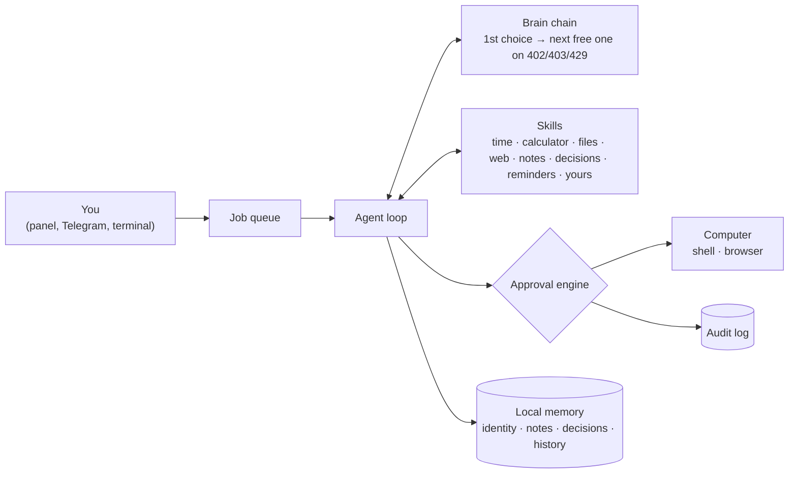

# 🤖 PocketAgent

[](https://github.com/wansjaxell/pocket-agent/actions/workflows/ci.yml)

**A small, local-first AI agent you can run on your own computer for free.**
Set it up in a local web panel, plug in one or more free brains, and talk to it from the panel
or from Telegram on any phone. It can use your computer too, but only what you approve.

- **One file to start:** download `PocketAgent.exe`, double-click, and the setup panel opens in your browser
- **Free brains, with fallbacks:** OpenRouter (sign in, no key to copy), Groq, Google AI Studio, NVIDIA,
  GitHub Models, Cerebras, Ollama, LM Studio, or any OpenAI-compatible API. If one runs out of free
  credit, the next one answers, and every answer says which brain wrote it
- **Its own memory:** name, personality, notes and a decision log that stay the same whichever brain you use
- **Your keys, encrypted if you want:** lock the panel with a password and the API keys are stored encrypted
- **Computer use with approvals:** off by default; when on, every action needs your OK, and one button stops everything
- **Tiny:** one dependency (`requests`), a single executable, 171 tests on Windows, macOS and Linux


## How it works



1. Your message goes to the first brain in your list, together with the tools it may use.
2. If the brain wants a tool (for example `calculate`), PocketAgent runs it and sends back the result.
   Tools that act on the computer go through the approval engine first.
3. This repeats (at most 8 steps) until the brain writes the final answer.

Models without native tool calling still work: tools are then described in the prompt instead
(`{"tool": ..., "arguments": ...}` in plain text). This is detected when you add the brain.

## Quick start

### Windows: one file
1. Download `PocketAgent-windows.exe` from [Releases](https://github.com/wansjaxell/pocket-agent/releases)
2. Double-click it. Windows SmartScreen may warn about an unsigned app: **More info → Run anyway**
3. Your browser opens the panel at `http://127.0.0.1:8765`. Follow the four steps (about 2 minutes)

Keep the PocketAgent window open while you use the agent; closing it stops the agent.

### Any computer with Python 3.10+
```bash
pip install git+https://github.com/wansjaxell/pocket-agent
pocketagent
```

### Android (Termux) and computers without a browser
Install [Termux from F-Droid](https://f-droid.org/packages/com.termux/), then:
```bash
pkg install python
pip install git+https://github.com/wansjaxell/pocket-agent
pocketagent setup
pocketagent telegram
```
`pocketagent setup` is the terminal version of the setup. A phone cannot run a 9B+ model well,
so choose a free cloud brain, or point it at the Ollama on your home computer (see below).

### iPhone and everything else
Run PocketAgent on a computer and chat with it through **Telegram**, which works on every platform.

## The setup panel

The panel is one page that only your own computer can open. Its four steps:

1. **Connect a brain.** Pick a provider. OpenRouter signs you in from the browser (OAuth PKCE): no key
   to copy. For the others, **Get your free key** opens the right page; paste the key, and the panel
   checks it and lists the models. Add as many brains as you like and put them in order.
2. **Connect Telegram** (optional). Create a bot with @BotFather, paste its token, then press START
   in your bot. The first person who presses START becomes the owner; everyone else is refused.
3. **Name your agent**, and optionally describe its personality.
4. **Access:** *open* (no password) or *locked* (a password, and the keys are stored encrypted).

The panel also has the chat, a **Safety** tab (computer use, approval rules, jobs, audit log), a
TR/EN language switch and the **STOP** button.

## Choosing a brain

| Provider | Cost | Notes |
|---|---|---|
| [OpenRouter](https://openrouter.ai) | free models available | sign in from the panel; free models are marked |
| [Groq](https://console.groq.com/keys) | free tier | very fast |
| [Google AI Studio](https://aistudio.google.com/apikey) (Gemini) | free tier | ⚠️ on the free tier your messages may be used to train Google's models |
| [NVIDIA build.nvidia.com](https://build.nvidia.com) | free tier | Nemotron models |
| [GitHub Models](https://github.com/settings/personal-access-tokens/new) | free with a GitHub account | fine-grained token with the *Models: Read* permission |
| [Cerebras](https://cloud.cerebras.ai) | free tier | very fast |
| [Ollama](https://ollama.com) | free | everything stays on your PC: `ollama pull qwen3.5:9b` |
| [LM Studio](https://lmstudio.ai) | free | everything stays on your PC: start its local server |
| Custom | | any OpenAI-compatible address, e.g. `http://192.168.1.5:11434/v1` |

**Fallbacks.** The first brain in your list answers. If it answers HTTP 402 (out of credit),
403 (refused) or 429 (rate-limited), the next *free* brain in your list answers instead; paid models
are never used as fallbacks. Other errors (a wrong key, a missing model) are shown, not hidden.
Under each answer you see the brain that wrote it, e.g. `🧠 Gemini · gemini-2.5-flash (↪ Groq · llama-3.3-70b-versatile: HTTP 429)`.

**Which local model fits your computer?**

| Graphics memory | Suggested models | |
|---|---|---|
| 8 GB | `qwen3.5:9b`, `granite4.2:8b` | fit in the GPU: fast |
| 16 GB+ (GPU or RAM) | `gpt-oss:20b`, `qwen3:30b` | mixture-of-experts: larger, slower if they spill into RAM |
| 24 GB+ | 32B dense models | a 32B model needs about 20 GB to run well |

### Use your PC's model from other devices
Let Ollama listen on your network (`OLLAMA_HOST=0.0.0.0`, then restart Ollama), and on the
other device choose **Custom** with `http://<your-pc-ip>:11434/v1`.

## Memory that belongs to the agent

These files belong to the agent, not to the brain. They are added to every conversation, so
switching to another model changes how it thinks, not who it is or what it knows:

| File (in `memory/`) | |
|---|---|
| `identity.json` | name and personality |
| `notes.json` | facts it was asked to remember (`remember`, `recall`, `forget`) |
| `decisions.jsonl` | the decision log: important decisions made with you (`record_decision`, `list_decisions`), append-only |
| `conversations.json` | recent conversation per chat |

## Computer use and approvals

Computer use is **off** by default (safe mode: chat only). In safe mode the agent cannot see or call
the computer tools. The sandboxed skills keep working: workspace files, web reading, notes, reminders.
Turn computer use on in the panel's **Safety** tab. Then:

- **Every action asks first**, in the panel and in Telegram (with buttons): *Allow once*, *Allow + remember*, *Deny*.
- **An approval opens a narrow rule, not a category.** A remembered approval matches only the exact
  same action: the same command in the same folder, or the same website. A new folder, recipient,
  amount or site is asked again.
- **Some things always ask and are never remembered:** spending money, deleting files, sending a
  message, passwords and keys, and **anything that comes after the agent read a web page, a file or
  command output in the same turn**. Instructions hidden in that content cannot trigger an action on
  their own (prompt-injection defence).
- **No ceilings:** there is deliberately no limit on how often an approved action may run.
- **STOP:** the big **STOP** button in the panel, or `/dur` (or `/stop`) in Telegram, stops everything
  at once: waiting approvals are denied, running commands are killed, queued jobs are cancelled, the
  current answer ends, and computer use is turned off until you turn it on again.
- **Saved rules** are listed in the Safety tab, where you can delete them one by one (`/kurallar` or
  `/rules` in Telegram lists them).
- **Everything is logged:** each tool call and each decision goes to `logs/audit.jsonl`, is shown in
  the Safety tab and is printed in the PocketAgent window.

The agent is a single agent with one background job queue: messages from the panel and Telegram are
answered one after another, while approvals and STOP are handled at once.

## Built-in skills

| Skill | Tools |
|---|---|
| basics | `get_current_time`, `calculate` (safe math, no `eval`) |
| files | `list_files`, `read_file`, `write_file` (only inside the workspace folder) |
| web | `web_search` (DuckDuckGo, no key), `fetch_webpage` |
| notes | `remember`, `recall`, `forget` |
| decisions | `record_decision`, `list_decisions` |
| reminders | `set_reminder`, `list_reminders`, `cancel_reminder` (delivered on Telegram or in the panel) |
| shell | `run_command`: PowerShell on Windows, `sh` elsewhere (computer use, approval for every command) |
| browser | `open_in_browser`: opens a page in your own browser (computer use, approval per site) |

### Write your own skill
A skill is a Python file with documented functions. Type hints and the docstring become the
tool description the model sees. Put the file in your skills folder and restart:

```python
from pocketagent.tools import tool

@tool
def roll_dice(sides: int = 6) -> str:
    """Roll a die.

    Args:
        sides: number of sides
    """
    import random
    return str(random.randint(1, sides))
```

A skill that acts on the computer is marked `@tool(os_access=True)` and asks first with
`ctx.approve(Action(kind, summary, params, scope=..., classes=...))` (see `pocketagent/skills/shell.py`).
Mark tools that return outside content with `untrusted_output=True`.

| | PocketAgent folder (settings, memory, skills, logs) |
|---|---|
| Windows | `%APPDATA%\PocketAgent\` (skills in `skills\`) |
| macOS / Linux | `~/.pocketagent/` |

A complete example (current weather, free API) is in [`examples/skills/weather.py`](examples/skills/weather.py).

## Commands

| Command | |
|---|---|
| `pocketagent` | opens the panel in your browser; Telegram and reminders run in the background |
| `pocketagent --no-browser` / `--port 9000` | start without opening the browser / on another port |
| `pocketagent setup` | terminal setup (for computers without a browser) |
| `pocketagent chat` | terminal chat only (approvals are asked in the terminal) |
| `pocketagent telegram` | Telegram bot only, without the panel |
| `pocketagent skills` | list loaded skills |
| `pocketagent doctor` | test the brains and Telegram |

In Telegram: `/dur` or `/stop` stops everything, `/kurallar` or `/rules` lists approval rules,
`/reset` clears the conversation, `/skills` lists what the agent can do.

**Start with Windows:** tick the option in the panel. It adds a shortcut to your Startup folder that
opens the normal PocketAgent window minimized (never hidden). In locked mode the browser opens so you
can type the password.

## Security

- **The panel only listens on 127.0.0.1.** Other computers on your network cannot reach it.
  Web pages you visit cannot use it either: the Host header must be `127.0.0.1` or `localhost`
  (against DNS rebinding), every API call needs a random token embedded in the page and requests from
  other origins are refused (against CSRF), and the page cannot be shown inside another site (against
  clickjacking). Everything from models and web pages is shown as text, never as HTML.
- **Locked mode** encrypts the API keys and the Telegram token with a key derived from your panel
  password: scrypt (N=2¹⁵, r=8) → AES-256-CTR + HMAC-SHA256 (encrypt-then-MAC). Python's standard
  library has no AES, and PocketAgent only depends on `requests`, so AES is a small pure-Python
  implementation checked against the FIPS-197 and NIST SP 800-38A test vectors. The password is
  never stored; if you forget it, the vault is deleted and you enter the keys again. In open mode the
  keys are stored as plain text in `config.json` in your user folder.
- **Telegram is owner-only.** The first person to press START during setup becomes the owner; every
  other chat is refused and never reaches the model, and their buttons do nothing.
- **Computer use** is off until you turn it on, and then every action needs your approval (see above).
- **File tools are sandboxed** to the workspace folder; paths like `../../Windows` are rejected.
- **Web pages, files and command output are untrusted:** the model is told not to follow instructions
  inside them, and any action after reading them needs a fresh approval.
- **The agent is never hidden:** it runs in a visible window and logs what it does.
- **Skills are code.** Only add skill files you have read or trust.

## Development

```bash
pip install -e ".[dev]"
pytest                                   # 171 tests, no network, model, Telegram or OS calls
pyinstaller --onefile --name PocketAgent --collect-submodules pocketagent.skills pocketagent/__main__.py
```

Tests replace the model servers, Telegram, the browser and the operating system with small fakes,
so they are fast and repeatable. Pushing a tag such as `v0.2.0` builds Windows, macOS and Linux
executables with GitHub Actions and attaches them to a release.

## Roadmap

- Voice messages (local speech-to-text)
- Image understanding with vision models
- More computer skills behind the approval engine (files outside the workspace, mail)
- Installing skills from a URL, with a review step
- MCP (Model Context Protocol) tool servers

## License

MIT
